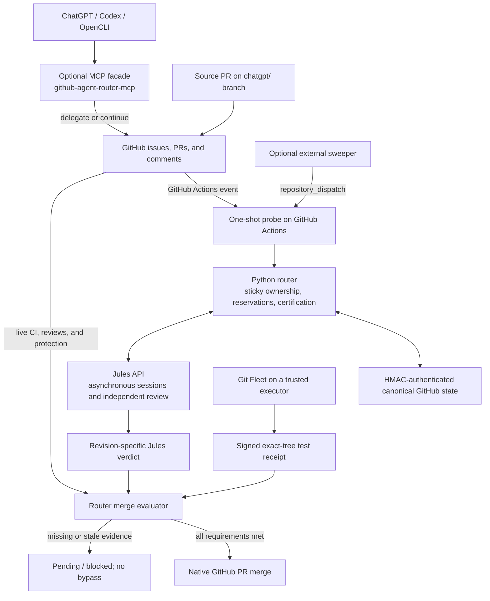
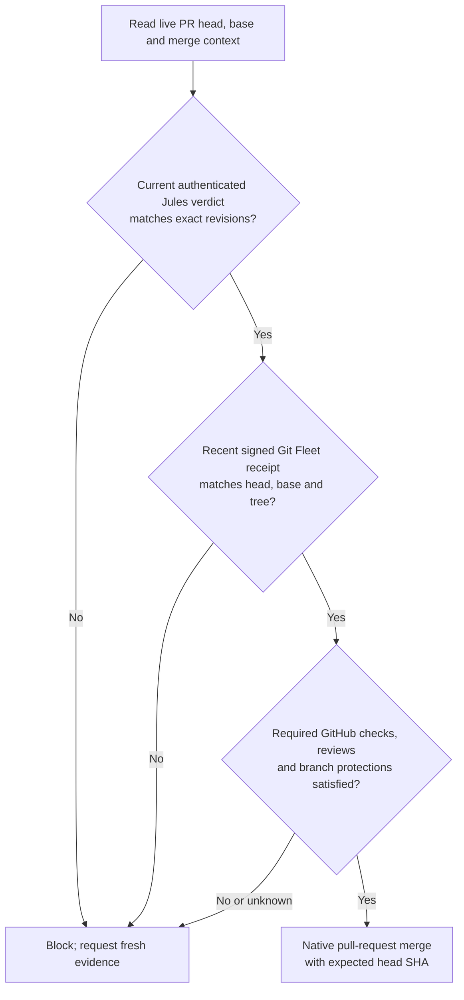
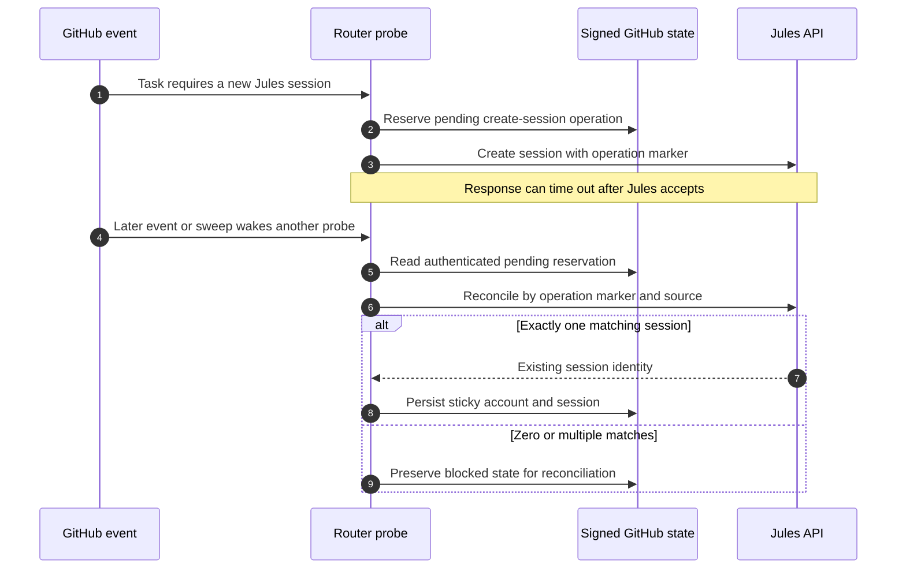

# GitHub Agent Router

Sticky GitHub-to-Jules routing with authenticated state, one-shot PR certification,
and revision-bound native merge decisions. Python 3.11+; no runtime dependencies.

## Architecture

Agent Router is the **coordination and merge-authority layer**, not a general-purpose build worker. The MCP facade is an optional front door; GitHub issues, PRs, workflow events, and authenticated comments provide the durable coordination surface. The diagram shows logical responsibilities, including optional components that require separate activation.



| Boundary | Execution location | What it owns |
| --- | --- | --- |
| [MCP facade](https://github.com/johnyoonh/github-agent-router-mcp) | Configured MCP transport | Repository/harness validation and GitHub signaling; **no direct Jules calls** |
| Router `probe` | GitHub-hosted Actions runner in the managed workflow (or an explicitly serialized external executor) | Jules routing, signed state, one bounded iteration and certification |
| Jules | Provider-hosted service | Asynchronous task execution and independent PR feedback |
| [Git Fleet](https://github.com/johnyoonh/git-fleet) | Workstation or trusted CI executor selected by the operator | Isolated Git worktree candidate, explicit checks and a revision-bound receipt |
| Sweeper | **Optional** external scheduler | Bounded wake-up dispatches and backoff; does not own Jules sessions or merge authority |
| Deployment | Separate repository-specific adapter/operator | Real environment promotion, health checks, rollback and device evidence |

GitHub Actions can process events with the developer's laptop powered off. A missing Git Fleet executor means local verification **waits**; it does not manufacture a receipt. A successfully completed router workflow is not Jules certification, and neither certification nor a GitHub merge proves deployment.

## Delivery boundary

ChatGPT/Codex produce a `chatgpt/` source PR. Jules independently checks the exact
source head and current base and returns behavioral/adversarial evidence. Any
repair PR is integrated back into the original source PR by git-fleet after a
combined-candidate test; the resulting source head is recertified.

`git-fleet verify-pr` supplies a signed receipt for the actual proposed merge tree.
The router checks that receipt, the signed Jules verdict, current GitHub required
checks, reviews, protection and revisions. Only the native PR merge endpoint is
used. A 403/404 is a permission/resource failure, never a signal to rewrite main
with the Git Data API. Merging and production/device validation remain separate.

## Revision-bound merge decision

A PR head SHA identifies the source branch's current commit; the base SHA identifies the destination branch's current commit. Git Fleet's **merge-tree SHA** identifies the resulting Git *tree object* after combining the exact revisions (and any explicitly selected repair heads). These are Git object identities, **not** local-machine or remote-machine locations.

| Identity | Source | Why a new value matters |
| --- | --- | --- |
| `head_sha` | Current source PR commit | A later push is unreviewed code, even if an older head passed |
| `base_sha` | Current destination branch commit | A newer base changes the integration context |
| `merge_tree_sha` | Exact candidate tree constructed and checked by Git Fleet | Tests on another combined tree do not authorize this one |



A source-head change, base advance, repair integration or different merged tree invalidates prior authorization. The regression `test_head_base_and_tree_must_match` in `tests/test_delivery.py` checks that mismatching any of these identities returns `blocked`. The merge evaluator uses the native GitHub endpoint and an expected head SHA; it does not rewrite the default branch as a fallback. See [delivery policy](docs/DELIVERY.md) and [certification protocol](docs/CERTIFICATION_LOOP.md).

**Separate gates:** The ordinary GitHub CI gate still runs independently of the router's `agent-certification` status. The router's read-only `merge-evaluate` does not perform a merge unless an authorized trusted executor explicitly supplies `--execute`. Production promotion, device tests and rollback remain outside this decision.

## Commands

```sh
github-agent-router --version
github-agent-router plan OWNER/REPO --policy /trusted/agent-routing.json
github-agent-router check OWNER/REPO --policy /trusted/agent-routing.json
github-agent-router provision OWNER/REPO --policy /trusted/agent-routing.json --router-ref REVIEWED_FULL_SHA --dry-run
github-agent-router probe
github-agent-router sweep OWNER/REPO --state /trusted/router-sweep.json --dry-run
github-agent-router merge-evaluate OWNER/REPO --pr 12 --receipt /evidence/pr12.json --policy /trusted/delivery-policy.json
```

`probe` processes one authenticated event and exits. It does not sleep while Jules
works. An iteration can succeed while certification is **pending** or **blocked**;
its execution result is not a merge gate. The separate `agent-certification`
commit status remains pending/failed until the matching revision is certified.
The existing repository `gate` check is never fabricated or replaced.

The `watch` command is now a deprecated compatibility alias for one-shot PR
processing; timeout/interval are accepted but ignored. New callers must use
`probe`. Do not use successful workflow completion as Jules certification.

## Security and coordination

Per-PR queued serialization covers normal events and external sweep dispatches.
Active mutations are not cancelled; signed pending-operation reservations make
uncertain external writes recoverable without blind retries. Sweeps use the
actual authenticated event sender and live PR state, never a fabricated owner.
Bookkeeping comments are filtered before runner allocation. An external bounded
sweeper stores backoff and dispatch reservations rather than parking an Actions
runner for polling.

Private repositories default to account A, public repositories to B. Existing
permitted ownership remains sticky. PR certification does not silently transfer
accounts or use overflow after an external operation. Legacy issue routing keeps
its existing policy behavior. Inventory planning/provisioning still uses explicit
repository selection and `repos/agent-routing.json`; credentials are never copied
into PRs or repository files.

Read [operations and migration](docs/OPERATIONS.md), the
[certification protocol](docs/CERTIFICATION_LOOP.md), and
[merge policy, exceptions and runner rollout](docs/DELIVERY.md).

## Asynchronous recovery and executor availability

Creating a Jules session or sending follow-up instructions crosses an API boundary that GitHub cannot make transactional. A timed-out request may have succeeded remotely, so replaying it blindly could duplicate work. The router signs a pending-operation reservation **before** the external write and reconciles uncertain outcomes instead.



The managed workflow supplies per-issue/PR queued concurrency with `cancel-in-progress: false`; the environment variable `AGENT_ROUTER_SERIALIZED=true` only **asserts** that an executor supplies exclusion and is not itself a lock. HMAC authenticates stored state but does not provide compare-and-swap or cross-provider exactly-once execution. Ambiguity blocks progression.

Each `probe` runs once and exits; no paid Actions runner polls for Jules to finish. A bounded `sweep` command and the optional `sweeper/` Cloudflare Worker implementation can dispatch future probes, but **provisioning does not deploy or schedule a sweeper**. Cloudflare Queues, Durable Objects and Workflows are possible future orchestration choices, not the current source of merge authority. They must not introduce a second writer to Jules ownership.

If a workstation is offline, hosted routing and GitHub CI can continue when triggered, but local Git Fleet testing cannot. On return, an explicit or scheduled Git Fleet pass must fetch the **current** refs and rerun verification; powering on a laptop alone is not evidence of an automatically resumed verification job.

**Operational migration caveat:** Other independent PR-merging automations (including legacy local merge scripts) must be disabled for strict-gate repositories or made to enforce this same certification-and-receipt policy. A strong new evaluator does not protect merges performed through another authorization path. See [operations and rollout](docs/OPERATIONS.md).

## Development

```sh
python -m pip install .
python -m unittest discover -s tests -p 'test_*.py' -v
python -W error -m compileall -q src tests
```

Synthetic API tests are not live Jules/GitHub or device evidence. Roll out a
reviewed immutable runtime pin and perform credentialed target smoke tests before
requiring `agent-certification` in a ruleset. Never silently weaken protection,
turn an unavailable check green, or declare a production deployment from unit tests.
